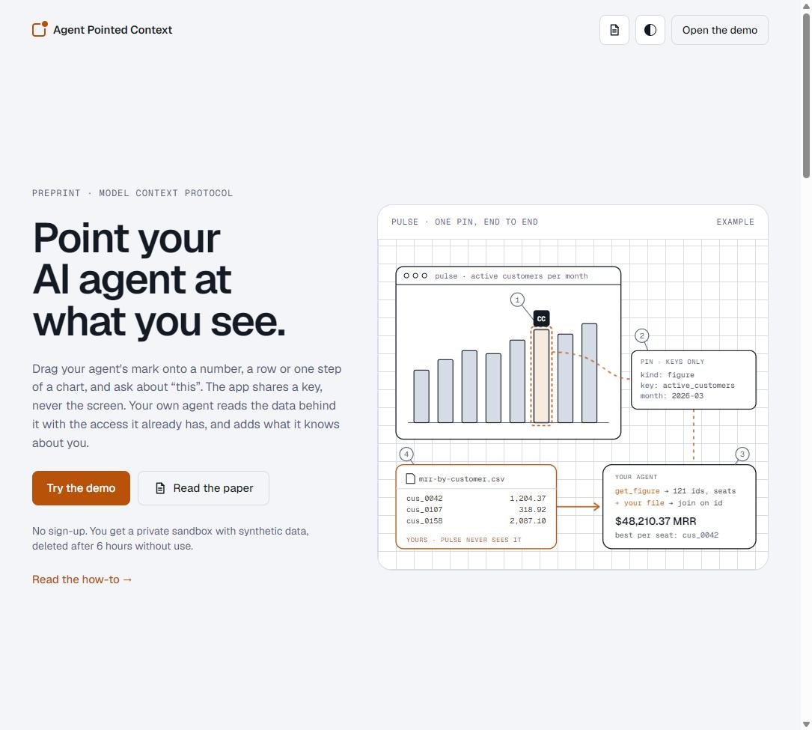
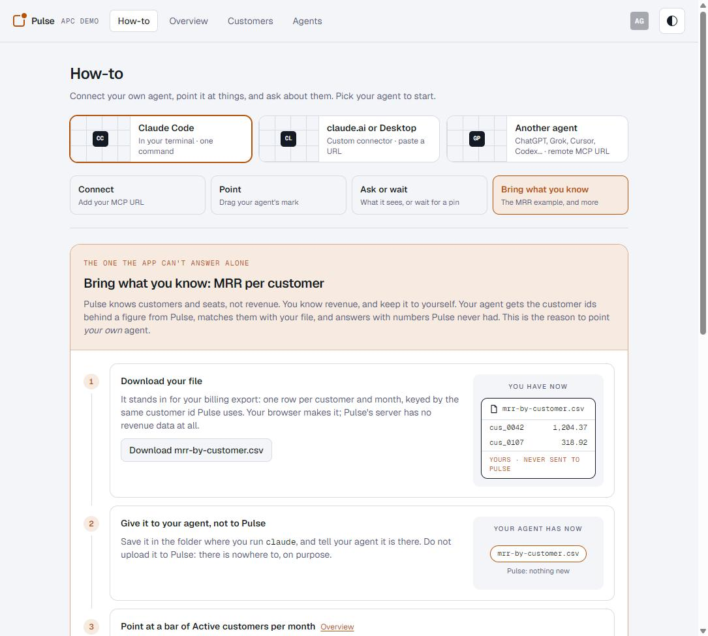

# Agent Pointed Context

[](https://doi.org/10.5281/zenodo.23404049) [](https://github.com/tineira/agent-pointed-context/actions/workflows/ci.yml)

Point your own AI agent at what you see in an app, without sharing the screen.

[](https://apc.tineira.com/v1/)

**Try it:** V1, the demo the paper describes, is at [apc.tineira.com/v1](https://apc.tineira.com/v1/); its landing opens no sandbox. Entering the demo creates or resumes a private sandbox with synthetic data, with no sign-up; it is deleted after 6 hours without use. The [how-to](https://apc.tineira.com/v1/how-to) takes about five minutes with Claude Code, claude.ai, ChatGPT, Grok, Cursor or any agent that accepts a remote MCP server by URL.

This repo is the open reference implementation and demo of **Agent Pointed Context (APC)**:

> T. Neira. *Agent Pointed Context: letting a person point an AI agent at what they see, without sharing the screen.* Zenodo, 2026. https://doi.org/10.5281/zenodo.23382909
>
> T. Neira. *Agent Pointed Context: design records and payload specification.* Zenodo, 2026. https://doi.org/10.5281/zenodo.23383101

## The idea

An app exposes three small channels to any agent connected over the [Model Context Protocol](https://modelcontextprotocol.io), and they carry identifiers and keys only, never pixels, text or amounts:

1. **View**: the screen the person is on, as identifiers (page, month, filters, at most one selected row).
2. **Pin**: the person drags their agent's mark onto a row, a cell or one step of a computed figure. The pin carries a key and the exact tool call that reads it (`next`, `next_args`). It reaches the agent on its next tool result, with no polling by the model, or right away through `wait_for_focus`.
3. **Presence**: each agent is a mark on screen and lights up on what it reads.

The agent reads what a pin points at through its ordinary tools, under the access it already has. And because it is **your own agent**, it already knows things the app does not: your files, your other tools, your memory. In the demo, Pulse (a fictional SaaS analytics app) knows customers and seats but not revenue; you give your agent a file of MRR per customer, point at a bar, and ask how much MRR it is. Your agent matches the customer ids behind the bar with your file and answers. Pulse never receives an MRR value.

[](https://apc.tineira.com/v1/how-to?topic=examples)

## What the demo shows

| Claim | Where to see it |
|---|---|
| Pointers, not content | the focus payload on the landing; tests refuse amounts and free text in pins and views |
| Delivery without polling by the model | the `attention` envelope on the next tool result, in the structured result and in the text |
| The pointer leads to the data, not the picture | `get_figure` returns the customer ids behind a bar or a bridge step |
| Same inputs, same function, same number | the page and the server import one pure function; a test compares them for every figure and month |
| Pointing grants no access | add a restricted agent (LATAM only): it gets a figure cut to its region, and is told so |
| Presence | each agent's mark pulses on its tool calls and outlines the rows it reads |
| The join happens in your agent | the MRR walkthrough; no server module can import the MRR generator (a test checks it) |
| Any MCP client | the How-to and Agents pages log, per agent, how it connected and read its pins |

Measurements (load test up to 150 visitors at once, CPU per request) are in [DESIGN.md §9b](DESIGN.md#9b-capacity-measured-2026-10-15-production).

## Use the pattern in your app

The packages go to npm as 0.x pre-releases on the `next` tag ([Using the packages](#using-the-packages)); in this workspace the apps use their TypeScript sources. They are small, so copying them is fine too.

| Package | What it gives you |
|---|---|
| [`@tineira/apc-protocol`](packages/protocol) | wire types, the target grammar (kinds, parts, key-only params), `data-focus` attributes |
| [`@tineira/apc-server`](packages/server) | `registerApcTools` (`get_current_view`, `wait_for_focus`), `attachAttention` for the envelope, `registerApcPrompts` (the `guide` prompt), `presenceEvent`; the Direct profile (`newDirectGrant`, `directMcpUrl`, `initializeOf`, `parseProfiles`), `apc_link` (`ApcLinks`, `registerApcLinkTool`, `sqlKv`) and `apc.json` (`apcManifest`, `apcJsonResponse`) |
| [`@tineira/apc-web`](packages/web) | `enablePinning` (drag a mark onto anything with `data-focus`; on a Direct-only app, the answer to a dock agent's drop), `flashTargets` for presence, `createViewReporter`, the agent bar `<apc-agents>` with Revoke, paths, Unlink and the dock hint, and the Direct agent list `<apc-direct-agents>` with the connect instructions (`connectPrompt`) |
| [`@tineira/apc-conformance`](packages/conformance) | the conformance suite: checks any APC app against the core of the standard through its MCP endpoint, in your tests or live with `npx @tineira/apc-conformance@next <app-origin>` |

On the server, register the two APC tools next to your own and attach the envelope to every result while a pin is unread:

```ts
import { registerApcTools, attachAttention, attentionFor, isUnread } from "@tineira/apc-server";

registerApcTools(server, {
  readView: async () => myViewTrimmedTo(grant),          // identifiers only, cut to the caller's access
  readFocus: async () => myPinFor(grant),                 // { kind, id, part, params, next, next_args, ... }
  focusUnread: async () => isUnread(await myPinRow(grant)),
  markSeen: async () => stampSeen(grant),
  sleep: (ms) => new Promise((r) => setTimeout(r, ms)),
});

// in your tool wrapper, after each tool runs:
if (isUnread(row) && focus) result = attachAttention(result, attentionFor(focus));
```

In the page, mark what can be pointed at and let the person drag their agent's mark onto it:

```tsx
import { focusAttrs } from "@tineira/apc-protocol";
import { enablePinning } from "@tineira/apc-web";

<g {...focusAttrs({ kind: "figure", params: { key: "active_customers", month: "2026-03" } })}>…</g>
<tr {...focusAttrs({ kind: "customer", id: "cus_0042" })}>…</tr>

enablePinning({ onPin: (grantId, target) => savePin(grantId, target) });
```

Every APC app implements the same core, whichever way agents reach it (directly on its own MCP URL, or once through a dock): the view, the pin, presence, the focus format, `get_current_view`, `wait_for_focus`, and Revoke in the app itself. [`packages/protocol/README.md`](packages/protocol/README.md#the-core) sums it up. To check your app against it, run the conformance suite on its MCP endpoint, with a small adapter for what happens in your page (the view it reports, the pin the person drops, the presence you send it, Revoke):

```ts
import { test } from "node:test";
import { apcConformance } from "@tineira/apc-conformance";

for (const check of apcConformance({
  name: "My app",
  profile: "direct",
  connect: async () => ({ mcpUrl, grantId }),               // a new agent with full access, no pin yet
  targets: [firstTarget, secondTarget],                       // two things the person can point at
  probe: { tool: "list_things", args: {} },                   // one of your read tools
  page: { setOpen, showView, pin, takePresence, revoke },     // your page, as your server sees it
})) test(check.name, check.run);
```

Pulse and Signals run it on both profiles in `pnpm test` with no network ([`apps/demo/test/conformance.test.ts`](apps/demo/test/conformance.test.ts), [`apps/signals/test/conformance.test.ts`](apps/signals/test/conformance.test.ts)); `@tineira/apc-conformance/workers` runs a Cloudflare Durable Object on Node for that. An app that offers both profiles also gives the adapter `link` (`connect(path)`, `agents()`, `unlink`), and the suite checks `apc_link`: the same agent on both paths is offered a code once per session, the code links them, an expired, reused, same-path or other-client code is refused, and Revoke on a linked agent cuts both grants.

**Publish `apc.json`.** Every APC app says what it is at `/.well-known/apc.json` on its own origin (APC 0.5): its name, the standard it implements, its origin, the profiles it offers, where its MCP URLs live and, with Direct, the page where the person connects an agent. A dock reads it before it pairs your app, and refuses the pairing when it is missing, names another origin, does not list `"dock"` or does not cover the MCP URL you sent; the conformance suite checks it too. With `@tineira/apc-server` it is one route:

```ts
import { apcJsonResponse, apcManifest, parseProfiles } from "@tineira/apc-server";

app.get("/.well-known/apc.json", (c) =>
  apcJsonResponse(apcManifest({ name: "My app", origin: new URL(c.req.url).origin, profiles: parseProfiles(c.env.APC_PROFILES), connect: "/connect" })),
);
```

`parseProfiles` reads the one string an app declares (Pulse and Signals: `APC_PROFILES`, e.g. `"direct,dock"`). Unset or blank means both; a set value with an unknown word fails closed to no profile, and `profilesRefusal(env.APC_PROFILES, "My app")` gives the 503 (with the reason logged) to answer your agent paths with, so a typo never opens a path.

**Your app works with the dock without being listed.** The dock at apc.tineira.com pairs any APC app on HTTPS that offers the Dock profile in its `apc.json`, not only Pulse and Signals. Until we verify it, people see a warning in their dock the first time your domain asks to pair (your domain, "Not verified", and what your app calls itself as its own word), and pair only when they approve it; your tools reach their agent under your domain (`example_com__<tool>`), marked untrusted, without annotations. Nothing changes in your app: the warning is the dock's, never your page's ([DESIGN.md § 18](DESIGN.md)).

If your app offers only Direct, still take a dock agent's drop so the person learns how to connect instead of nothing happening: pass `profiles: () => loadApcProfiles()` (your own apc.json) and `direct: { name, connect }` to `enablePinning`, and it answers such a drop (holding one made before the file is read) with a note and your connect link, or calls your `onDockUnsupported`. The browser extension gives the same answer on a Direct-only app that does not.

To offer the Direct profile (each agent on its own MCP URL), your Durable Object makes grants with `newDirectGrant()` in its own table, answers `initialize` with `ApcLinks.arrived(grant, linkClient(initializeOf(body), path))`, and wraps its tools so a result carries `attachApcLink(result, await links.offer(grant, tool))`; the page shows `<apc-direct-agents>` (make, name, URL and prompt to copy) and passes each agent's `paths` to `<apc-agents>`. Declare your profiles in one place (`APC_PROFILES="direct,dock"` in Pulse's and Signals' `wrangler.jsonc`). Signals is the small example ([`apps/signals/src/worker/feed.ts`](apps/signals/src/worker/feed.ts)).

The demo is the full worked example: [`apps/v1/src/worker`](apps/v1/src/worker) (the sandbox, the MCP endpoint, grant trimming, the figure registry) and [`apps/v1/src/web`](apps/v1/src/web) (marks, pins, presence), V1 as the paper describes it, frozen with its own copy of the packages in [`apps/v1/src/apc`](apps/v1/src/apc). [`apps/demo`](apps/demo) is the same Pulse moving on with the APC standard.

## Using the packages

`@tineira/apc-protocol`, `@tineira/apc-server`, `@tineira/apc-web` and `@tineira/apc-conformance` go to npm together, as 0.x pre-releases on the `next` dist-tag (never `latest` before the standard is 1.0). Their version follows the standard's: 0.7.x ships APC 0.7 (`APC_STANDARD_VERSION`).

```sh
npm i @tineira/apc-protocol@next @tineira/apc-web@next                                # the page
npm i @tineira/apc-server@next @modelcontextprotocol/sdk zod                  # the server (the SDK and zod are peers)
npx @tineira/apc-conformance@next https://your.app --grant <an agent's MCP URL>   # check a live app
```

They are ESM with type declarations. `@tineira/apc-protocol` and `@tineira/apc-web` have no Node imports (`@tineira/apc-web` is browser code for any bundler); `@tineira/apc-server` runs wherever there are `fetch` and Web Crypto (Workers, Node 20+); `@tineira/apc-conformance` needs Node 22.15+. Each package's README has a minimal example; the docs are at https://apc.tineira.com/docs.

`apc-conformance` checks over HTTP what HTTP reaches: the app's `apc.json` and, with `--grant` (an agent's MCP URL, Direct profile), `initialize`, the core tools and their arguments, the shapes of `get_current_view`, `attention` and `then`, `wait_for_focus` timing, an unknown grant's 404 and, with `--revoked`, a revoked grant's 403. `PASS`, `FAIL` or `SKIP` per check, exit 1 on a failure, `--json` for the report. What needs the person's page (a pin, the page open or closed, presence, Revoke pressed, mobile, `apc_link`) is reported `SKIP`: run `apcConformance` with an adapter for that (above). It reads only that origin, over https (`--allow-http` for localhost), never follows a redirect, caps every answer and times out every request.

**Releasing them.** In the workspace each package's `exports` point at `src/`; what pnpm publishes points at `dist/` (`publishConfig`), and `workspace:^` becomes `^<version>`. `pnpm build:packages` builds `dist/` (tsc, ESM and `.d.ts`), and `pnpm check:packages` checks that the four share one version that matches `APC_STANDARD_VERSION`; `pnpm build` runs both. Pack with pnpm, not npm: a pack with npm stops, since only pnpm writes the published manifest. Publishing is npm's, from those tarballs.

To release, set the four versions, merge, and push the tag `apc-v<version>`. [`.github/workflows/publish.yml`](.github/workflows/publish.yml) runs only for that tag (a manual run is a dry run). It checks the tag against the versions, typechecks, tests, builds, packs the four with pnpm, and runs `npm publish <tarball> --tag next --access public` for each one, `@tineira/apc-protocol` first. It uses npm [trusted publishing](https://docs.npmjs.com/trusted-publishers): there is no npm token. npm trusts this repository's `publish.yml` through GitHub's OIDC token (`id-token: write`, npm 12.2.1 on Node 24), and adds provenance by itself. Each `package.json` has `repository.url` exactly `https://github.com/tineira/agent-pointed-context`, which `check-packages` enforces, because npm compares it.

**The first publish, once, by hand.** A trusted publisher can only be set on a package that exists, so 0.7.0 goes out from a maintainer's machine:

```sh
npm login                                   # the npm account that owns the @tineira scope
git status                                  # clean, on the commit to publish (main after this merges)
node scripts/publish-local.mjs --dry-run    # builds, packs, npm publish --dry-run per package
node scripts/publish-local.mjs              # npm publish <tgz> --tag next --access public per package; 2FA each time
```

[`scripts/publish-local.mjs`](scripts/publish-local.mjs) refuses to run when the tree has changes, when the four versions do not match each other and `APC_STANDARD_VERSION`, or (outside a dry run) when `npm whoami` fails. It builds `dist/` and packs with `pnpm -r --filter "./packages/*" pack` into a temporary folder. Then it runs `npm publish <folder>/tineira-apc-<pkg>-0.7.0.tgz --tag next --access public` for protocol, server, web and conformance, in that order, and stops at the first failure. After that, on npmjs.com, open each of the four packages, go to Settings, then Trusted Publisher, then GitHub Actions, and set: user `tineira`, repository `agent-pointed-context`, workflow filename `publish.yml`, no environment. Each one must see a successful publish within 2 days of being set, so tag the next version soon after, or re-check with a manual (dry) run. From then on, the tag is all it takes.

## The agent's manual (optional)

The server already tells every agent the essentials (its instructions, the tool descriptions, the `attention` and `then` keys). The full manual is opt-in, in two forms with the same text:

- **MCP prompt `guide`**, for one session: `/mcp__pulse__guide` in Claude Code, the + menu in Claude Desktop, or wherever your client lists MCP prompts.
- **Skill `pulse-agent`**, installed once for your CLI agent: `npx skills add https://github.com/tineira/agent-pointed-context --skill pulse-agent` ([`skills/pulse-agent/SKILL.md`](skills/pulse-agent/SKILL.md)).

The skill documents V1, so its text lives in V1's frozen copy (`apcGuide()` in `apps/v1/src/apc/server/prompts.ts` and Pulse's part in `apps/v1/src/worker/guide.ts`); `node scripts/build-skill.mjs` regenerates the skill file, and a test (`apps/v1/test/guide.test.ts`) fails if the two drift.

## Run it

Node 24 and pnpm through corepack:

```sh
corepack pnpm install
corepack pnpm typecheck
corepack pnpm test
corepack pnpm dev          # Pulse for the APC standard (apps/demo): http://localhost:5173 (Vite + the local Workers runtime)
corepack pnpm --dir apps/v1 dev   # V1, frozen: http://localhost:5173/v1/
```

V1 lives in [`apps/v1`](apps/v1) and everything it serves is under `/v1` ([`apps/v1/README.md`](apps/v1/README.md)): the landing at `/v1/` opens no sandbox, even when you already have one; its demo links (`/v1/how-to`, `/v1/overview`, …) create or resume your sandbox, and the MCP URLs are `/v1/mcp/<sandbox>/<secret>`. Until the APC standard's landing takes the root (phase 0c), `/` redirects to `/v1/`.

Deploy your own copy of V1 to Cloudflare Workers (the free plan is enough to try it):

```sh
cd apps/v1
npx wrangler login
# in wrangler.jsonc, remove the "routes" entry or point it at your own domain
node node_modules/vite/bin/vite.js build && npx wrangler deploy
```

apc.tineira.com itself deploys from CI: every push to `main` that passes the checks and changes `apps/v1/` runs `wrangler deploy` there (`.github/workflows/ci.yml`, with the repository secrets `CLOUDFLARE_API_TOKEN` and `CLOUDFLARE_ACCOUNT_ID`).

On Windows the local Workers runtime needs the Microsoft Visual C++ Redistributable, and it sometimes crashes when a new sandbox starts; the page retries. Deployed, this does not happen.

## Layout

| Path | What |
|---|---|
| `packages/protocol` | wire types and the target grammar |
| `packages/server` | the attention envelope, `get_current_view`, `wait_for_focus`, presence events |
| `packages/web` | drag-to-pin, presence marks, view reporting, the agent bar and pin badge |
| `packages/conformance` | the conformance suite for the core of the standard, the `apc-conformance` command (the checks HTTP reaches, against a live app), and a Durable Object stand-in for Node |
| `scripts/build-packages.mjs`, `scripts/check-packages.mjs`, `scripts/publish-local.mjs` | build the four packages' `dist/` for npm, check their versions and manifests before a release (`.github/workflows/publish.yml`), and the one-time first publish by hand |
| `apps/v1` | V1, frozen (TIN-604): Pulse as the paper describes it, at apc.tineira.com/v1 (Worker `apc-demo`), with its own copy of the three packages in `src/apc`; changed only to keep it running ([README](apps/v1/README.md)) |
| `apps/demo` | Pulse for the APC standard: a Cloudflare Worker with one Durable Object per visitor, a Vite + React front end, paired from the dock (`apc-pulse`, pulse.apc.tineira.com) |
| `apps/signals` | The APC standard: Signals, a market feed (competitor offers and our ads, from the same seed as Pulse) as the second APC app (`apc-signals`, signals.apc.tineira.com) |
| `apps/dock` | The APC standard: the agent dock and its attention hub, and the landing page of apc.tineira.com (its own Worker, `apc-dock`, at apc.tineira.com) |
| `apps/extension` | The APC standard: the browser extension for Chrome and Edge (TIN-421): any page you allow takes the agent you drag from the dock or Float, and the agent reads the text you dropped it on; `node build.mjs` builds `dist/`, `--dev` builds `dist-dev/` for a local dock |
| `apps/desktop` | The APC standard: Pulse for desktop, a Windows app (Avalonia, .NET 8) that takes the dock's agent dropped from the browser; tests in `apps/desktop-tests`, the `.exe` built by `.github/workflows/desktop.yml` |
| `apps/dock-desktop` | The APC standard: the dock for Windows (Tauri v2): the dock page in its own window, its agents as desktop pets on top of every window (each its own frameless window: drag it onto an app to point it, and by the grip that shows above it on hover to move it; Alt+Shift+Space, tray); `npx @tauri-apps/cli@2.12.2 build` from that folder builds the installer (needs Rust), `APC_DOCK_ORIGIN=http://localhost:5200` points it at a local dock (with the pets in a debug build only: `cargo run`); built by `.github/workflows/dock-desktop.yml`, which publishes each build of `main` to the [`dock-desktop` prerelease](https://github.com/tineira/agent-pointed-context/releases/download/dock-desktop/APCDockSetup.exe) the web dock links to on Windows |
| `scripts/mobile-e2e.mjs` | the mobile rule in a real Chrome at 375 x 812 with touch emulation (DevTools Protocol): Pulse's and Signals' agent bars and pins by touch, the conformance mobile checks |
| `scripts/extension-e2e.mjs` | the extension end to end in a real Chrome or Edge (DevTools Protocol): pairing in the dock, readings, an APC app keeping its drop, Unpair |
| `scripts/loadtest.mjs` | the load test behind DESIGN.md §9b |
| `scripts/mcp-sessions.mjs` | distinct agent sessions per day and client, from Analytics Engine, Pulse v1's and the dock's (needs the `ANALYTICS_SALT` secret on each Worker) |
| `skills/pulse-agent` | the agent's manual as an installable skill (generated by `scripts/build-skill.mjs`) |
| `DESIGN.md` | design, decisions, measurements |

## What the hosted demo stores

Per sandbox, until it is deleted 6 hours after its last use: its seed, its agents' grants (with the client name and, if the client sent one, its small raster icon), your current view (identifiers only, and you can switch it off), pins, and an event log of tool calls including their arguments (so you can check what your agent sent). The MRR file is made in your browser and never sent. One count outlives the sandbox: when an agent connects (MCP `initialize`), the Worker writes a point to Cloudflare Analytics Engine with the client's name and version, the grant's label, its user agent, and two keyed hashes (of the sandbox and grant, and of the IP), never the IP, the sandbox id or the grant secret; Analytics Engine keeps it about three months. `node scripts/mcp-sessions.mjs` reads back distinct agent sessions per day and client. Cloudflare keeps its usual request logs for the Worker.

## Releases and changelogs

Two things are versioned apart. The **software** (Pulse, the dock, Signals, the extension, the desktop apps) is tagged `v0.1.0`, `v0.2.0` and so on, and [`CHANGELOG.md`](CHANGELOG.md) lists what changed, with an `Unreleased` section for what has merged since the last tag. The **APC standard**, the contract an app and an agent share (view, pin, presence, the focus format, `wait_for_focus`, the tools, the drag payload, pairing), has its own semver, `APC_STANDARD_VERSION` in `@tineira/apc-protocol`, and its own [changelog](packages/protocol/CHANGELOG.md). It stays 0.x while it is a draft and becomes 1.0.0 when it is published; the paper's version (V1) is not a 1.x of it. CI fails a pull request that changes more than docs and updates neither changelog, unless it carries the `no-changelog` label.

## Status

Cut 1 is live; the canary check over the event log is `node scripts/canary.mjs <events.jsonl> <mrr-by-customer.csv>`. Open work is tracked in [issues](https://github.com/tineira/agent-pointed-context/issues): the plan and seat screens, reusing the MCP server per agent, the client compatibility matrix across agents, per-client connection guides, and the evaluation harness (cut 2).

The APC standard (one agent across apps: a dock you drag your agent from onto any APC app; it was called APC v2 while it was built) is developed in `apps/dock`, deployed on its own Worker (`apc-dock`) at apc.tineira.com, with Pulse (`apps/demo`, `apc-pulse`) at pulse.apc.tineira.com and Signals (`apps/signals`, `apc-signals`) at signals.apc.tineira.com. Since 2026-11-03 apc.tineira.com is the standard's home; V1 stays at [apc.tineira.com/v1](https://apc.tineira.com/v1/), served by the same Worker as before through two zone routes. V1 is frozen in `apps/v1` with its own copy of the packages (TIN-604), so the `@tineira/apc-*` packages and `apps/demo` may change freely; CI deploys V1 only when `apps/v1/` changes, and the standard when `apps/dock`, `apps/signals`, `apps/demo`, the packages or the lockfile change. To try the standard: open apc.tineira.com and click **Open your dock**. You only need an agent that can add a remote MCP server; nothing to install first. A checklist stays beside your agent and checks itself as you try each feature, in any order. Connect your agent once by dragging the plug into its chat, or using its MCP URL or QR. Open Pulse, an example APC app, from the checklist; drag your agent onto a bar, choose **Allow** in Pulse and then **Allow** in the dock (check the app and its address), and ask your agent “what is this?”. The dock creates a demo world silently, so Pulse and Signals open with matching made-up data; **Change world** is in the menu. Next open Signals, the second example app, drop your agent on a post, allow both sides and ask what explains the churn: no new MCP connection is needed, and your agent reads both apps and joins them while the apps share nothing. The checklist also offers the browser extension ([download and install it step by step](https://apc.tineira.com/extension), without building anything): drop the agent on any paragraph, and its first page reading checks that item. **Keep it at hand** is optional: Float, install the dock as an app, the Windows dock with desktop pets, or [Pulse for Windows](https://github.com/tineira/agent-pointed-context/releases/download/pulse-desktop/PulseDesktop.exe). For Pulse for Windows, paste the dock’s Pulse link into the app, click **Open world**, then drag the agent from the dock onto a step, bar or customer. The dock stores, for 7 days after its last use, its agents (client name and icon), the apps each is paired with (with the MCP URL each app gave it), each app's last view, where each agent points, and each agent's last 300 calls through it (the tool, the app, the time, the pin it read, errors; TIN-419, shown on the agent's page under **Details**); never the calls' arguments or app results. With the browser extension (TIN-421), the dock also stores, for each agent, the browsers you allowed to send it page readings, and the last reading from each: the page's address (no query string), its title and the text you dropped the agent on, kept 10 minutes at most. That text passes through Cloudflare, where the dock runs; the dock deletes it on time, but Cloudflare's point-in-time recovery can restore a Durable Object's storage up to 30 days back, so a deleted reading stays recoverable there by whoever controls the account until then (the dock never does this). Each reading also leaves a line in a log of the agent's last 50, with the site, the time and the size only (TIN-422), listed with **Clear** in the extension's popup and on the agent's page; a reading's text is never logged. Like V1, when an agent connects to the dock (MCP `initialize`), the dock's Worker writes a point to the same Analytics Engine dataset, marked as the dock's (TIN-416): the client's name and version, the agent's label, its user agent, and two keyed hashes (of the dock and agent, and of the IP), never the IP, the dock id or the agent's secret. `node scripts/mcp-sessions.mjs` lists these sessions too, marked `[dock]`.

To try the browser extension (TIN-421, TIN-465, DESIGN.md §13), follow the [illustrated install steps](https://apc.tineira.com/extension): download the ready-to-use zip, unzip it into a folder you keep, and load that folder in Chrome or Edge. For developers building from source: clone this repo, run `pnpm install`, then `node build.mjs` in `apps/extension`, open `chrome://extensions` (or `edge://extensions`), turn on Developer mode, click **Load unpacked** and pick `apps/extension/dist`. A welcome page opens: click **Let me drop my agent on any page** (one grant; you can also allow sites one by one from the extension's icon instead), and choose when to be asked. Then drag your agent from the dock or Float onto a paragraph on any page. The first drop on a site asks on a card in the page: **Just this once**, **Always on this site** or **Not here**; government sites (`.gob`, `.gov`) and `.bank` and `.insurance` sites ask every time, and so does any site you set to **Always ask** from the extension's icon (your bank, email or health sites are not recognised by name: set them yourself), unless you turn on **Never ask**, which sends every drop at once. The first drop of an agent in this browser also asks in the dock to allow this browser. Then ask your agent about "this" and it reads what you dropped it on (`page__get_reading`). Your agent's mark stays pinned on that paragraph: orange until your agent reads it, green once it has, grey once you drop it somewhere newer; × removes it, and your agent forgets that reading. Drag the pin to another paragraph to point your agent there instead; Esc puts it back. The extension's icon also has **Open dock** (Alt+Shift+A) and **Float** (Alt+Shift+F), which opens your dock ready to float your agents with one click. The page's text goes to your agent through your dock and is untrusted: the agent is told never to follow instructions in it. To update the extension after a new build, click its reload button in `chrome://extensions`.

Security issues: please use GitHub's private vulnerability reporting (Security tab), not a public issue.

## Credits

The look follows [hue-switch-console](https://github.com/tineira/hue-switch-console) by the same author, reused here under MIT. Its colour themes come from the [Omarchy](https://github.com/basecamp/omarchy) palettes (MIT). Fonts: [Geist](https://vercel.com/font) (SIL Open Font License).

## Cite

This software: T. Neira. *Agent Pointed Context: reference implementation and demo.* Zenodo. https://doi.org/10.5281/zenodo.23404049 (all versions; v0.1.0 is https://doi.org/10.5281/zenodo.23404050). See also [CITATION.cff](CITATION.cff). Please cite the paper for the pattern itself.

## License

MIT for the code (see [LICENSE](LICENSE)). The paper and its companion record are CC BY 4.0.
