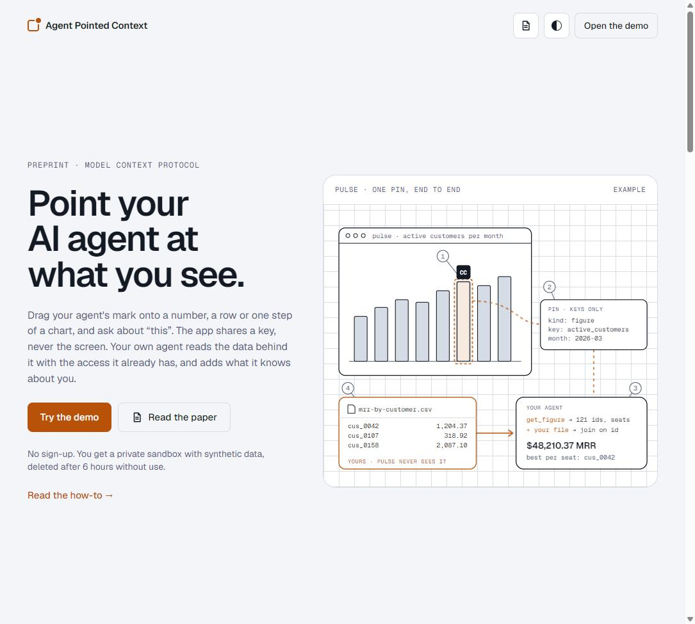
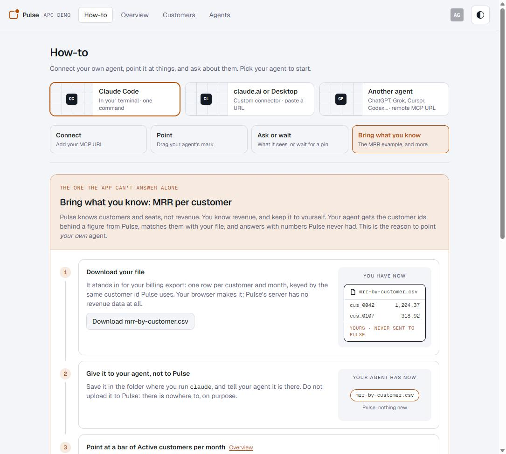

# Agent Pointed Context

[](https://doi.org/10.5281/zenodo.23404049) [](https://github.com/tineira/agent-pointed-context/actions/workflows/ci.yml)

Point your own AI agent at what you see in an app, without sharing the screen.

[](https://apc.tineira.com)

**Try it:** [apc.tineira.com](https://apc.tineira.com). No sign-up: each visitor gets a private sandbox with synthetic data, deleted after 6 hours without use. The [how-to](https://apc.tineira.com/how-to) takes about five minutes with Claude Code, claude.ai, ChatGPT, Grok, Cursor or any agent that accepts a remote MCP server by URL.

This repo is the open reference implementation and demo of **Agent Pointed Context (APC)**:

> T. Neira. *Agent Pointed Context: letting a person point an AI agent at what they see, without sharing the screen.* Zenodo, 2026. https://doi.org/10.5281/zenodo.23382909
>
> T. Neira. *Agent Pointed Context: design records and payload specification.* Zenodo, 2026. https://doi.org/10.5281/zenodo.23383101

## The idea

An app exposes three small channels to any agent connected over the [Model Context Protocol](https://modelcontextprotocol.io), and they carry identifiers and keys only, never pixels, text or amounts:

1. **View**: the screen the person is on, as identifiers (page, month, filters, at most one selected row).
2. **Pin**: the person drags their agent's mark onto a row, a cell or one step of a computed figure. The pin carries a key and the exact tool call that reads it (`next`, `next_args`). It reaches the agent on its next tool result, with no polling by the model, or right away through `wait_for_focus`.
3. **Presence**: each agent is a mark on screen and lights up on what it reads.

The agent reads what a pin points at through its ordinary tools, under the access it already has. And because it is **your own agent**, it already knows things the app does not: your files, your other tools, your memory. In the demo, Pulse (a fictional SaaS analytics app) knows customers and seats but not revenue; you give your agent a file of MRR per customer, point at a bar, and ask how much MRR it is. Your agent matches the customer ids behind the bar with your file and answers. Pulse never receives an MRR value.

[](https://apc.tineira.com/how-to?topic=examples)

## What the demo shows

| Claim | Where to see it |
|---|---|
| Pointers, not content | the focus payload on the landing; tests refuse amounts and free text in pins and views |
| Delivery without polling by the model | the `attention` envelope on the next tool result, in the structured result and in the text |
| The pointer leads to the data, not the picture | `get_figure` returns the customer ids behind a bar or a bridge step |
| Same inputs, same function, same number | the page and the server import one pure function; a test compares them for every figure and month |
| Pointing grants no access | add a restricted agent (LATAM only): it gets a figure cut to its region, and is told so |
| Presence | each agent's mark pulses on its tool calls and outlines the rows it reads |
| The join happens in your agent | the MRR walkthrough; no server module can import the MRR generator (a test checks it) |
| Any MCP client | the How-to and Agents pages log, per agent, how it connected and read its pins |

Measurements (load test up to 150 visitors at once, CPU per request) are in [DESIGN.md §9b](DESIGN.md#9b-capacity-measured-2026-10-15-production).

## Use the pattern in your app

The packages are TypeScript sources in this workspace (not on npm yet). They are small, so copying them is fine too.

| Package | What it gives you |
|---|---|
| [`@apc/protocol`](packages/protocol) | wire types, the target grammar (kinds, parts, key-only params), `data-focus` attributes |
| [`@apc/server`](packages/server) | `registerApcTools` (`get_current_view`, `wait_for_focus`), `attachAttention` for the envelope, `registerApcPrompts` (the `guide` prompt), `presenceEvent` |
| [`@apc/web`](packages/web) | `enablePinning` (drag a mark onto anything with `data-focus`), `flashTargets` for presence, `createViewReporter` |

On the server, register the two APC tools next to your own and attach the envelope to every result while a pin is unread:

```ts
import { registerApcTools, attachAttention, attentionFor, isUnread } from "@apc/server";

registerApcTools(server, {
  readView: async () => myViewTrimmedTo(grant),          // identifiers only, cut to the caller's access
  readFocus: async () => myPinFor(grant),                 // { kind, id, part, params, next, next_args, ... }
  focusUnread: async () => isUnread(await myPinRow(grant)),
  markSeen: async () => stampSeen(grant),
  sleep: (ms) => new Promise((r) => setTimeout(r, ms)),
});

// in your tool wrapper, after each tool runs:
if (isUnread(row) && focus) result = attachAttention(result, attentionFor(focus));
```

In the page, mark what can be pointed at and let the person drag their agent's mark onto it:

```tsx
import { focusAttrs } from "@apc/protocol";
import { enablePinning } from "@apc/web";

<g {...focusAttrs({ kind: "figure", params: { key: "active_customers", month: "2026-03" } })}>…</g>
<tr {...focusAttrs({ kind: "customer", id: "cus_0042" })}>…</tr>

enablePinning({ onPin: (grantId, target) => savePin(grantId, target) });
```

The demo is the full worked example: [`apps/demo/src/worker`](apps/demo/src/worker) (the sandbox, the MCP endpoint, grant trimming, the figure registry) and [`apps/demo/src/web`](apps/demo/src/web) (marks, pins, presence).

## The agent's manual (optional)

The server already tells every agent the essentials (its instructions, the tool descriptions, the `attention` and `then` keys). The full manual is opt-in, in two forms with the same text:

- **MCP prompt `guide`**, for one session: `/mcp__pulse__guide` in Claude Code, the + menu in Claude Desktop, or wherever your client lists MCP prompts.
- **Skill `pulse-agent`**, installed once for your CLI agent: `npx skills add https://github.com/tineira/agent-pointed-context --skill pulse-agent` ([`skills/pulse-agent/SKILL.md`](skills/pulse-agent/SKILL.md)).

The text lives in one place (`apcGuide()` in `packages/server/src/prompts.ts` and Pulse's part in `apps/demo/src/worker/guide.ts`); `node scripts/build-skill.mjs` regenerates the skill file, and a test fails if the two drift.

## Run it

Node 24 and pnpm through corepack:

```sh
corepack pnpm install
corepack pnpm typecheck
corepack pnpm test
corepack pnpm dev          # http://localhost:5173 (Vite + the local Workers runtime)
```

Deploy your own copy to Cloudflare Workers (the free plan is enough to try it):

```sh
cd apps/demo
npx wrangler login
# in wrangler.jsonc, remove the "routes" entry or point it at your own domain
node node_modules/vite/bin/vite.js build && npx wrangler deploy
```

apc.tineira.com itself deploys from CI: every push to `main` that passes the checks runs `wrangler deploy` (`.github/workflows/ci.yml`, with the repository secrets `CLOUDFLARE_API_TOKEN` and `CLOUDFLARE_ACCOUNT_ID`).

On Windows the local Workers runtime needs the Microsoft Visual C++ Redistributable, and it sometimes crashes when a new sandbox starts; the page retries. Deployed, this does not happen.

## Layout

| Path | What |
|---|---|
| `packages/protocol` | wire types and the target grammar |
| `packages/server` | the attention envelope, `get_current_view`, `wait_for_focus`, presence events |
| `packages/web` | drag-to-pin, presence marks, view reporting |
| `apps/demo` | Pulse, the demo app: a Cloudflare Worker with one Durable Object per visitor, a Vite + React front end |
| `apps/signals` | APC v2: Signals, a market feed (competitor offers and our ads, from the same seed as Pulse) as the second APC app (`apc-v2-signals`, signals.v2.apc.tineira.com) |
| `apps/dock` | APC v2, in progress: the agent dock and its attention hub (its own Worker, `apc-v2`, at v2.apc.tineira.com); Pulse's v2 deploy is `apps/demo` with `CLOUDFLARE_ENV=v2` (`apc-v2-pulse`, pulse.v2.apc.tineira.com) |
| `apps/extension` | APC v2: the browser extension for Chrome and Edge (TIN-421): any page you allow takes the agent you drag from the dock or Float, and the agent reads the text you dropped it on; `node build.mjs` builds `dist/`, `--dev` builds `dist-dev/` for a local dock |
| `apps/desktop` | APC v2: Pulse for desktop, a Windows app (Avalonia, .NET 8) that takes the dock's agent dropped from the browser; tests in `apps/desktop-tests`, the `.exe` built by `.github/workflows/desktop.yml` |
| `apps/dock-desktop` | APC v2: the dock for Windows (Tauri v2): the dock page in its own window, its agents in a strip on top of every window (Alt+Shift+Space, tray); `npx @tauri-apps/cli@2.12.2 build` from that folder builds the installer (needs Rust), `APC_DOCK_ORIGIN=http://localhost:5200` points it at a local dock; built by `.github/workflows/dock-desktop.yml`, which publishes each build of `main` to the [`dock-desktop` prerelease](https://github.com/tineira/agent-pointed-context/releases/download/dock-desktop/APCDockSetup.exe) the web dock links to on Windows |
| `scripts/extension-e2e.mjs` | the extension end to end in a real Chrome or Edge (DevTools Protocol): pairing in the dock, readings, an APC app keeping its drop, Unpair |
| `scripts/loadtest.mjs` | the load test behind DESIGN.md §9b |
| `scripts/mcp-sessions.mjs` | distinct agent sessions per day and client, from Analytics Engine, Pulse v1's and the dock's (needs the `ANALYTICS_SALT` secret on each Worker) |
| `skills/pulse-agent` | the agent's manual as an installable skill (generated by `scripts/build-skill.mjs`) |
| `DESIGN.md` | design, decisions, measurements |

## What the hosted demo stores

Per sandbox, until it is deleted 6 hours after its last use: its seed, its agents' grants (with the client name and, if the client sent one, its small raster icon), your current view (identifiers only, and you can switch it off), pins, and an event log of tool calls including their arguments (so you can check what your agent sent). The MRR file is made in your browser and never sent. One count outlives the sandbox: when an agent connects (MCP `initialize`), the Worker writes a point to Cloudflare Analytics Engine with the client's name and version, the grant's label, its user agent, and two keyed hashes (of the sandbox and grant, and of the IP), never the IP, the sandbox id or the grant secret; Analytics Engine keeps it about three months. `node scripts/mcp-sessions.mjs` reads back distinct agent sessions per day and client. Cloudflare keeps its usual request logs for the Worker.

## Status

Cut 1 is live; the canary check over the event log is `node scripts/canary.mjs <events.jsonl> <mrr-by-customer.csv>`. Open work is tracked in [issues](https://github.com/tineira/agent-pointed-context/issues): the plan and seat screens, reusing the MCP server per agent, the client compatibility matrix across agents, per-client connection guides, and the evaluation harness (cut 2).

APC v2 (one agent across apps: a dock you drag your agent from onto any APC app) is developed in parallel in `apps/dock`, deployed on its own Worker at v2.apc.tineira.com, with a second deploy of Pulse at pulse.v2.apc.tineira.com, so apc.tineira.com is never touched; CI deploys v1 when anything outside `apps/dock` changes and v2 when `apps/dock`, `apps/signals`, `apps/demo` or the packages change. What v2 needs from the `@apc/*` packages goes in as additive, opt-in options that v1 does not turn on; a breaking change would version APC (0.3 / 1.0) with v1 pinned to 0.2. To try the dock prototype (TIN-370): open apc.tineira.com/overview?apc=v2, click **Dock**, and drag an agent from that window onto a bar in Pulse. Pulse and the dock talk over postMessage; the drag carries only the agent's public handle. To try APC v2: open v2.apc.tineira.com (the APC v2 landing, TIN-420: what the dock is, how it works, the demo apps; a visitor who already has a dock goes straight on to v2.apc.tineira.com/dock), click **Open your dock** and follow its steps: the dock (in Chrome or Edge you can install it as an app, and **Float** keeps your agents on top), your agent (add the dock's MCP URL to it: it connects only there, since the apps have no agent of their own), and your world (the number both apps invent their data from, so they line up), then Pulse (in the browser, or Pulse for desktop for Windows) and Signals, each on that world. The dock's **Pulse** and **Signals** buttons open both apps on the dock's own demo world (the same customers, and a market that lines up with them); neither app links to the other. Drag the agent from the dock onto a bar in Pulse, allow it in Pulse and then in the dock, and ask your agent about "this". Do the same on a post in Signals (competitor offers aimed at a region and plan, our ads with a promo code) and ask what explains the churn or where the new customers came from: your agent reads both apps and joins them; the apps share nothing. To try it with an installed app (TIN-396): download [PulseDesktop.exe](https://github.com/tineira/agent-pointed-context/releases/download/pulse-desktop/PulseDesktop.exe) (the dock offers it too), run it, paste the dock's Pulse link (or its seed) and click **Open world**, then drag the agent from the dock in Chrome or Edge onto a step, a bar or a customer in the app. The dock stores, for 7 days after its last use, its agents (client name and icon), the apps each is paired with (with the MCP URL each app gave it), each app's last view, where each agent points, and each agent's last 300 calls through it (the tool, the app, the time, the pin it read, errors; TIN-419, shown on the agent's page under **Details**); never the calls' arguments or app results. With the browser extension (TIN-421), the dock also stores, for each agent, the browsers you allowed to send it page readings, and the last reading from each: the page's address (no query string), its title and the text you dropped the agent on, kept 10 minutes at most and never logged. Like Pulse v1, when an agent connects to the dock (MCP `initialize`), the dock's Worker writes a point to the same Analytics Engine dataset, marked as the dock's (TIN-416): the client's name and version, the agent's label, its user agent, and two keyed hashes (of the dock and agent, and of the IP), never the IP, the dock id or the agent's secret. `node scripts/mcp-sessions.mjs` lists these sessions too, marked `[dock]`.

To try the browser extension (TIN-421, TIN-465, DESIGN.md §13): run `pnpm install`, then `node build.mjs` in `apps/extension`, open `chrome://extensions` (or `edge://extensions`), turn on Developer mode, click **Load unpacked** and pick `apps/extension/dist`. A welcome page opens: click **Let me drop my agent on any page** (one grant; you can also allow sites one by one from the extension's icon instead), and choose when to be asked. Then drag your agent from the dock or Float onto a paragraph on any page. The first drop on a site asks on a card in the page: **Just this once**, **Always on this site** or **Not here**; government sites (`.gob`, `.gov`) and `.bank` and `.insurance` sites ask every time, and so does any site you set to **Always ask** from the extension's icon (your bank, email or health sites are not recognised by name: set them yourself), unless you turn on **Never ask**, which sends every drop at once. The first drop of an agent in this browser also asks in the dock to allow this browser. Then ask your agent about "this" and it reads what you dropped it on (`page__get_reading`). Your agent's mark stays pinned on that paragraph: orange until your agent reads it, green once it has, grey once you drop it somewhere newer; × removes it, and your agent forgets that reading. Drag the pin to another paragraph to point your agent there instead; Esc puts it back. The extension's icon also has **Open dock** (Alt+Shift+A) and **Float** (Alt+Shift+F), which opens your dock ready to float your agents with one click. The page's text goes to your agent through your dock and is untrusted: the agent is told never to follow instructions in it. To update the extension after a new build, click its reload button in `chrome://extensions`.

Security issues: please use GitHub's private vulnerability reporting (Security tab), not a public issue.

## Credits

The look follows [hue-switch-console](https://github.com/tineira/hue-switch-console) by the same author, reused here under MIT. Its colour themes come from the [Omarchy](https://github.com/basecamp/omarchy) palettes (MIT). Fonts: [Geist](https://vercel.com/font) (SIL Open Font License).

## Cite

This software: T. Neira. *Agent Pointed Context: reference implementation and demo.* Zenodo. https://doi.org/10.5281/zenodo.23404049 (all versions; v0.1.0 is https://doi.org/10.5281/zenodo.23404050). See also [CITATION.cff](CITATION.cff). Please cite the paper for the pattern itself.

## License

MIT for the code (see [LICENSE](LICENSE)). The paper and its companion record are CC BY 4.0.
